# 🔍 DFIR Case Study: Jigsaw Ransomware on Windows 10

> End-to-end digital forensics and malware analysis of a Windows 10 machine infected with **Jigsaw ransomware**: from building the infected lab and acquiring a forensic E01 image, through root-cause analysis in Autopsy, to behavioural analysis, IOC extraction, a working kill switch, and MITRE ATT&CK mapping.


> ⚠️ **This repository contains no malware.** Only hashes, screenshots, and analysis notes are published. All work was done in an isolated VM.

---

## 📑 Table of Contents

1. [Case Summary](#1-case-summary)
2. [Lab Environment & Toolkit](#2-lab-environment--toolkit)
3. [Building the Evidence](#3-building-the-evidence)
4. [Evidence Acquisition](#4-evidence-acquisition)
5. [Disk Forensics & Root Cause (Autopsy)](#5-disk-forensics--root-cause-autopsy)
6. [Malware Analysis](#6-malware-analysis)
7. [Registry Impact](#7-registry-impact)
8. [Kill Switch](#8-kill-switch)
9. [Indicators of Compromise](#9-indicators-of-compromise)
10. [MITRE ATT&CK Mapping](#10-mitre-attck-mapping)
11. [Detection & Response Recommendations](#11-detection--response-recommendations)
12. [Challenges & Lessons Learned](#12-challenges--lessons-learned)
13. [Repository Structure](#13-repository-structure)
14. [Disclaimer](#14-disclaimer)

---

## 1. Case Summary

| Item | Detail |
|---|---|
| **Victim system** | Windows 10 x64 VM (VMware Workstation), user `The Dell PC` |
| **Malware** | Jigsaw ransomware (.NET / MSIL, a.k.a. BitcoinBlackmailer) |
| **Date of infection** | 14 Oct 2024, ~15:23–15:27 PKT |
| **Evidence** | E01 disk image acquired with FTK Imager |
| **Root cause** | User opened a sample archive with WinRAR and executed `Jigsaw.exe` from WinRAR's temporary extraction folder |
| **Impact** | Personal files encrypted, ransom note displayed, payload copied to `AppData` with autorun persistence |
| **Containment** | Kill process `drpbx.exe`; rolling the system date back before 1 Apr 2016 stops the payload (Section 8) |

## 2. Lab Environment & Toolkit

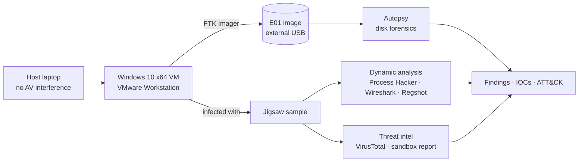

| Phase | Tools |
|---|---|
| Acquisition | FTK Imager (E01) |
| Disk forensics | Autopsy (Recent Activity, Prefetch, Registry, Web, Shellbags, USB modules) |
| Process monitoring | Process Hacker, Process Monitor |
| Network | Wireshark |
| Registry diffing | Regshot (before/after snapshots) |
| Threat intelligence | VirusTotal, online sandbox report |
| Framework | MITRE ATT&CK |

## 3. Building the Evidence

No suitable public compromised Windows image was available, so the infected system had to be built from scratch. Getting a clean, analysable infection took several attempts. This is covered in detail in [Section 12](#12-challenges--lessons-learned).

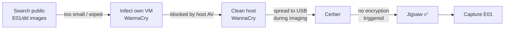

## 4. Evidence Acquisition

- Acquired the infected VM's disk with **FTK Imager** in **E01 (Expert Witness)** format, which stores the image with embedded hash verification and case metadata.
- Stored the image on an external drive that was connected **after** the ransomware was contained. An earlier WannaCry attempt showed that a live infection will reach any attached storage.
- Loaded the E01 into **Autopsy** as the data source `jigsaw_forensics_image.E01` and ran the ingest modules.

## 5. Disk Forensics & Root Cause (Autopsy)

The goal was to reconstruct **what ran, when, and how it got there** using only artifacts from the disk image.

### 5.1 Timeline reconstruction

| Time (PKT, 14 Oct 2024) | Artifact | Finding |
|---|---|---|
| 09:56 | Installed Programs (SOFTWARE hive) | WinRAR and other tools installed |
| 15:10–15:22 | Recent Documents (`.lnk`) | User opens `Ransomware-Samples\` folders: RedBoot, WannaCry, Matsnu |
| 15:23:46 | Recent Documents (`Jigsaw.lnk`) | User opens `Desktop\Ransomware-Samples\Jigsaw` |
| 15:27:22 | Shellbags (UsrClass.dat) | Folder `Ransomware-Sample\Jigsaw` browsed |
| 15:27:24 | Web History (Edge WebCache) | `file:///…/Ransomware-Samples/Jigsaw/Ransomware.Jigsaw.zip` opened |
| 15:27:30 | Prefetch (`JIGSAW.EXE-*.pf`) | **`JIGSAW.EXE` executed** from `%TEMP%\Rar$EX…` (WinRAR temp folder) |
| after 15:27 | Filesystem | Files encrypted, Jigsaw image dropped in Pictures |

### 5.2 Artifacts examined

**Recent Documents:** `.lnk` files in `AppData\Roaming\Microsoft\Windows\Recent` show exactly which sample folders the user opened, and when.

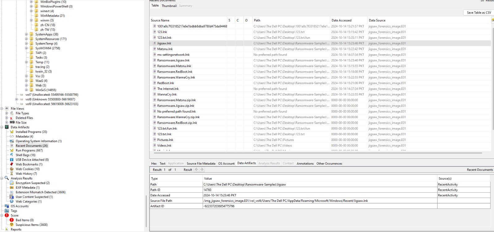

**Prefetch / Run Programs:** the prefetch entry proves `JIGSAW.EXE` executed, and its path shows it ran from inside a WinRAR temporary extraction directory. That means the user double-clicked it straight from the archive.

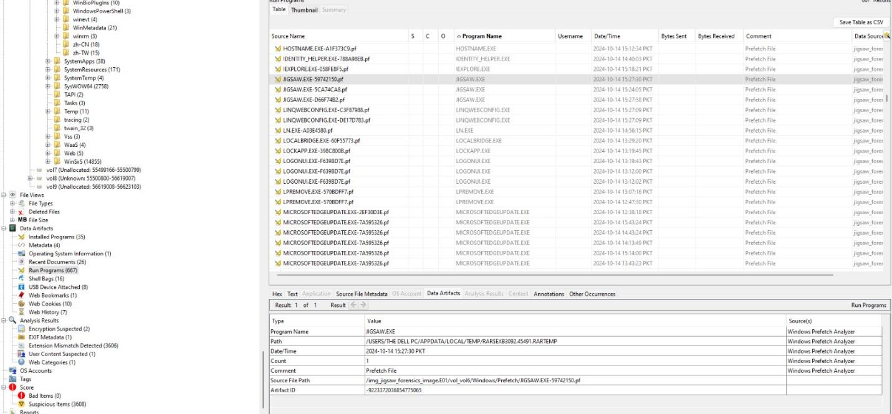

**Installed Programs:** confirms WinRAR on the system, the tool used to open the archive. No unknown or unauthorised installers were present.

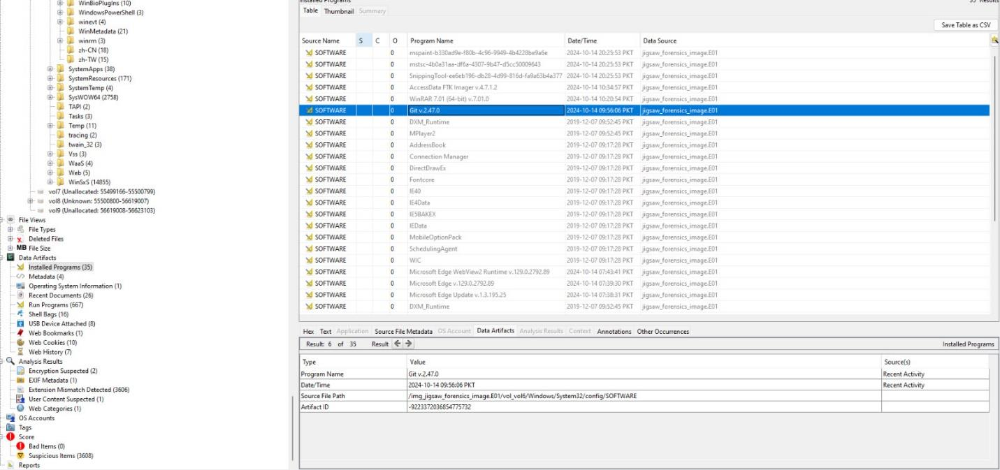

**Web History:** the Edge WebCache shows only `file://` URLs to the local sample archives, not internet downloads. This rules out a drive-by or browser-download vector.

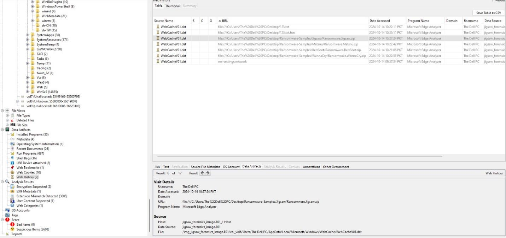

**Shellbags:** `UsrClass.dat` shellbags confirm folder navigation into each sample directory, corroborating the `.lnk` timeline.

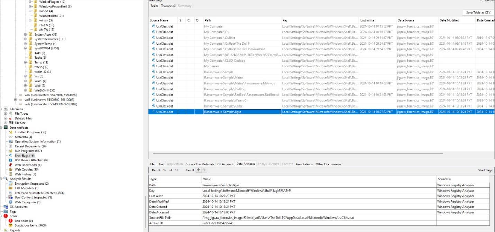

**USB Devices:** only VMware virtual hubs and mouse devices were present, with no external mass storage before the infection. This rules out USB as the infection vector.

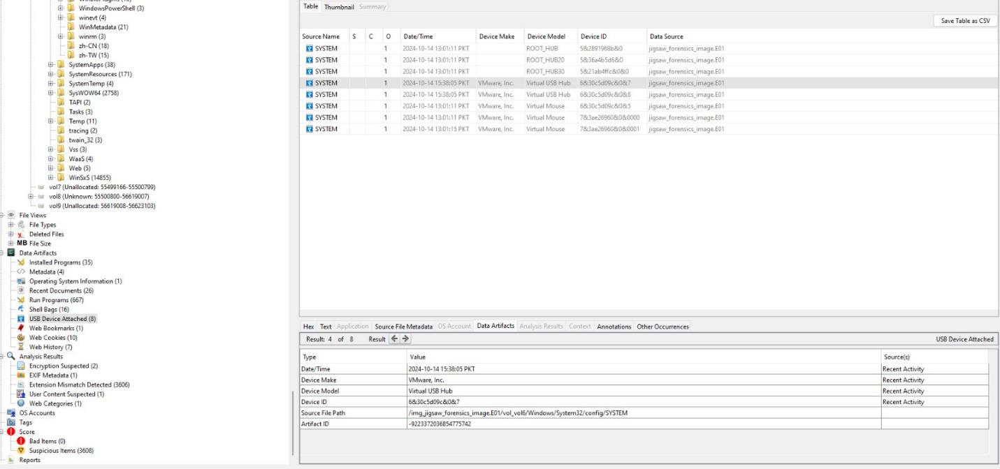

### 5.3 Root cause

> **Manual execution of `Jigsaw.exe` from a local sample archive opened in WinRAR.** There was no network or USB delivery vector. The infection was user-initiated, which is the same pattern as a real-world phishing attachment that the user extracts and runs.

## 6. Malware Analysis

### 6.1 Static reputation (VirusTotal)

| Sample | Detection | Notes |
|---|---|---|
| Modified Jigsaw sample (`Ransomware.Jigsaw.zip`) | **0 / 61** | Altered training sample; known signatures no longer matched |
| Original `Jigsaw.exe` | **55 / 72** | Labelled `ransomware.msil/cloudsword`; family: msil, cryptolocker |
| `BitcoinBlackmailer.exe` (payload) | **64 / 71** | Labelled `trojan.jigsaw/msil`; tags: persistence, detect-debug-environment, via-tor |

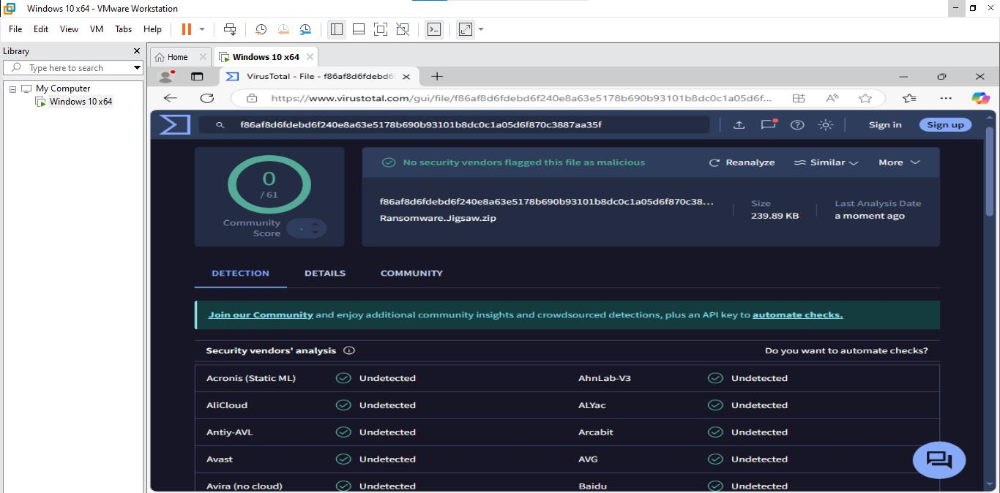 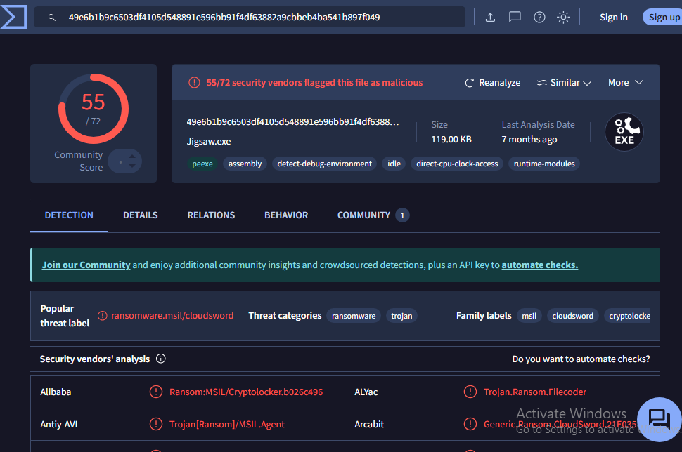

**Takeaway:** a 0-detection result does not mean a file is safe. Hash-based detection fails against even lightly modified samples, which is why behavioural detection matters.

### 6.2 Process behaviour

Process Hacker and the sandbox process tree show the dropper spawning **`drpbx.exe`**, the long-running ransomware process that handles encryption and the ransom countdown.

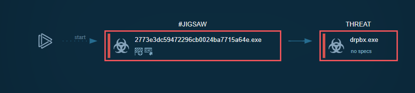

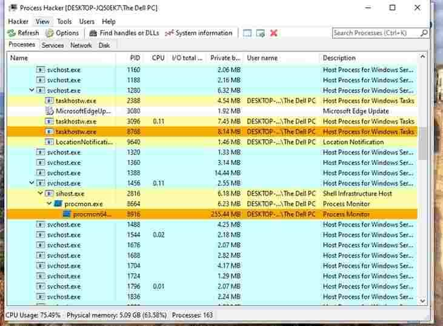

### 6.3 Dropped files

The dropper writes two copies of itself (same hash) to user-writable locations:

| Path | MD5 |
|---|---|
| `%APPDATA%\Frfx\firefox.exe` | `2773e3dc59472296cb0024ba7715a64e` |
| `%LOCALAPPDATA%\Drpbx\drpbx.exe` | `2773e3dc59472296cb0024ba7715a64e` |

Naming the copies `firefox.exe` and `drpbx.exe` (Dropbox) is masquerading meant to blend in with legitimate software.

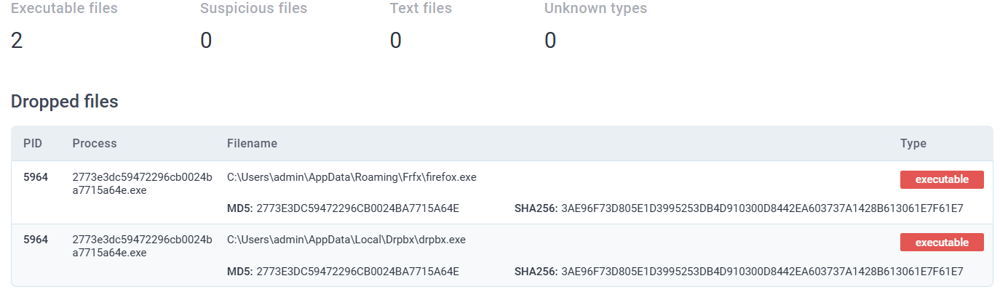

### 6.4 Behaviour summary

| Severity | Behaviour |
|---|---|
| 🔴 Malicious | Changes autorun value in the registry (persistence) |
| 🔴 Malicious | Jigsaw family signature matched |
| 🟠 Suspicious | Reads Internet Explorer security settings |
| 🟠 Suspicious | Drops / overwrites executable content |
| 🟠 Suspicious | Reads Windows installation date |
| 🟠 Suspicious | Starts itself from another location |
| 🔵 Info | Checks system language and location settings |
| 🔵 Info | Reads the computer name |
| 🔵 Info | ConfuserEx obfuscation detected (YARA) on `drpbx.exe` |
| 🔵 Info | Creates files in user directories |

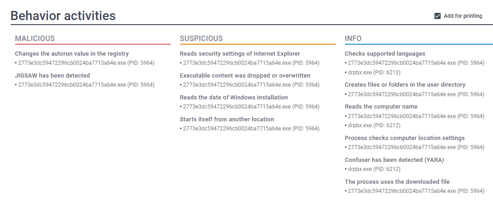

### 6.5 Network

Wireshark captured traffic from the VM during execution, so any C2 or IP indicators could be identified and blocked at the perimeter. Infrastructure IOCs associated with Jigsaw are listed in [Section 9](#9-indicators-of-compromise).

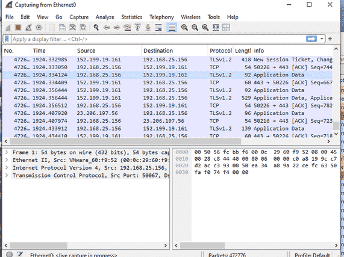

## 7. Registry Impact

Before and after registry snapshots were compared to identify what the ransomware touched. Changes were recorded under these locations:

| Registry location | Purpose | Why it matters |
|---|---|---|
| `HKCU\…\CurrentVersion\Run` | Per-user autostart | **Persistence:** payload relaunches at logon |
| `HKLM\…\CurrentVersion\Run` | System-wide autostart | Persistence for all users |
| `HKCU\…\Policies\System` | User policy (e.g. Task Manager) | Can block the user from killing the process |
| `HKCU\…\Explorer\Advanced` | Explorer view settings | Hiding file extensions disguises executables |
| `HKCU\…\Explorer\Shell Folders` | Desktop/Documents paths | Used to locate user files for encryption |
| `HKCU\Control Panel\Desktop` | Wallpaper and desktop settings | Ransom display / desktop changes |
| `HKLM\SYSTEM\…\Services\EventLog` | Event logging | Tampering reduces forensic visibility |
| `HKLM\…\CurrentVersion\Uninstall` | Installed programs list | Queried for discovery |
| `HKLM\SOFTWARE\Microsoft\Cryptography` | Crypto settings / MachineGuid | Machine fingerprinting |

Several .NET component keys (`Accessibility`, `AuditPolicyGPManagedStubs.Interop`, `Microsoft.KeyDistributionService.Cmdlets`, `Microsoft.Management.Infrastructure`) were also modified, affecting accessibility, audit, and management tooling.

## 8. Kill Switch

**Option 1: Terminate the process.** End `drpbx.exe` in Task Manager or Process Hacker. This stops the encryption and deletion countdown immediately, but persistence brings it back at the next logon unless the Run key and dropped files are removed.

**Option 2: Roll back the system date.** Jigsaw checks the system date against a hard-coded threshold of **1 April 2016**. With the clock set to **2 January 2016**, the sample was launched and **did not execute its payload**: no encryption and no ransom screen.

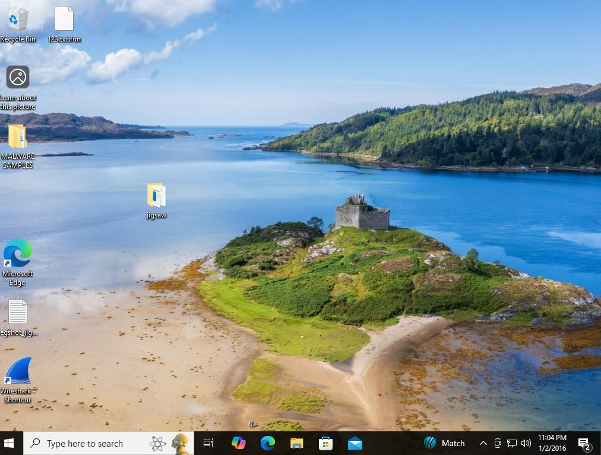 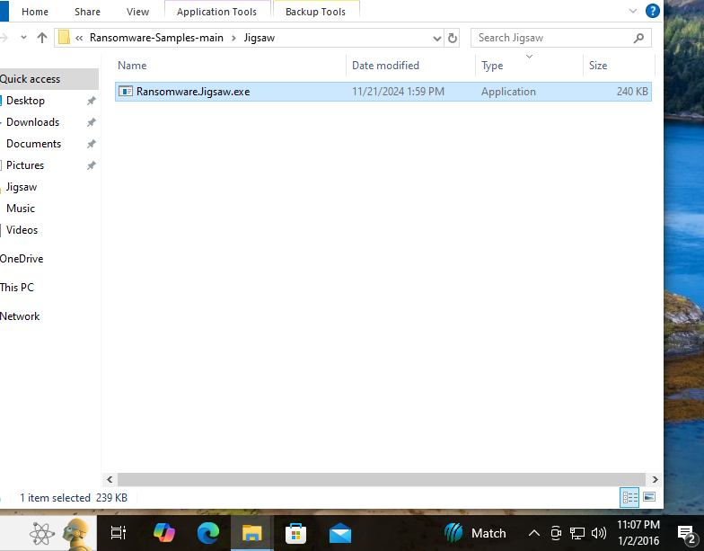

> This is a temporary containment measure, not remediation. Decryption tools for Jigsaw are publicly available (e.g. from No More Ransom), and full cleanup means removing the Run key entries and the `Frfx` / `Drpbx` folders.

## 9. Indicators of Compromise

Full machine-readable list: [`iocs/iocs.csv`](iocs/iocs.csv) · hashes only: [`iocs/hashes.txt`](iocs/hashes.txt)

**File hashes: Jigsaw payload (BitcoinBlackmailer.exe / drpbx.exe)**

| Type | Value |
|---|---|
| SHA-256 | `3ae96f73d805e1d3995253db4d910300d8442ea603737a1428b613061e7f61e7` |
| SHA-1 | `27d99fbca067f478bb91cdbcb92f13a828b00859` |
| MD5 | `2773e3dc59472296cb0024ba7715a64e` |

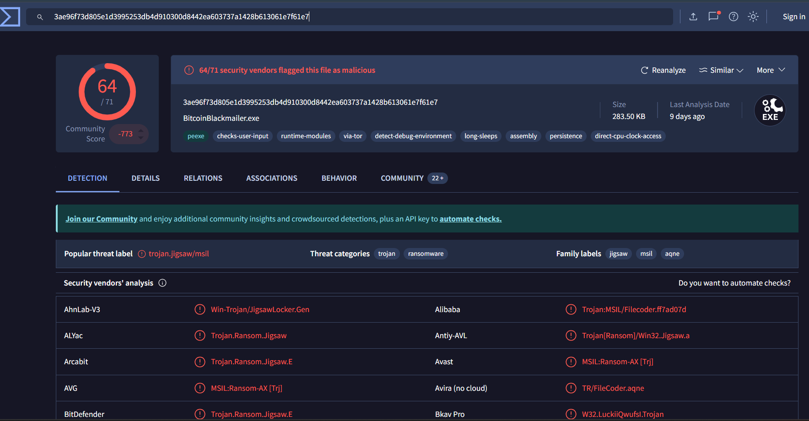

**Host indicators**
- `%APPDATA%\Frfx\firefox.exe`
- `%LOCALAPPDATA%\Drpbx\drpbx.exe`
- Run-key entry pointing to either path

**Network indicators** (defanged, from threat-intel sources)

| IPs | Domains |
|---|---|
| `45.144.225[.]16` | `blablaez.duckdns[.]org` |
| `83.244.163[.]204` | `service-updater.hopto[.]org` |
| `193.117.208[.]146` | `sf3q2wrq34.ddns[.]net` |
| | `totes.bluetoes[.]org` |
| | `demourl.co[.]nf` |

## 10. MITRE ATT&CK Mapping

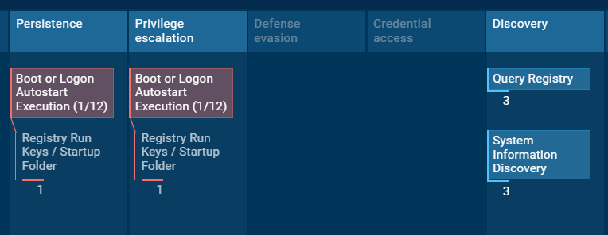

| Tactic | Technique | Evidence in this case |
|---|---|---|
| Execution | **T1204.002** User Execution: Malicious File | Prefetch shows `JIGSAW.EXE` run by the user from the WinRAR temp folder |
| Persistence / Privilege Escalation | **T1547.001** Registry Run Keys / Startup Folder | Autorun value changed; payload relaunches at logon |
| Defense Evasion | **T1036** Masquerading | Copies named `firefox.exe` and `drpbx.exe` |
| Defense Evasion | **T1027** Obfuscated Files or Information | ConfuserEx detected by YARA |
| Discovery | **T1012** Query Registry | Reads IE security settings, install date, Uninstall key |
| Discovery | **T1082** System Information Discovery | Reads computer name, language, and locale |
| Impact | **T1486** Data Encrypted for Impact | User files encrypted, ransom demanded |

## 11. Detection & Response Recommendations

- **Alert on executables launched from archive temp paths** (`%TEMP%\Rar$EX*`, `%TEMP%\7z*`), a common phishing pattern.
- **Monitor Run-key writes** pointing into `%APPDATA%` or `%LOCALAPPDATA%` subfolders (Sysmon Event ID 13).
- **Flag process-name masquerading:** e.g. `firefox.exe` running from anywhere other than `Program Files`.
- **Block the hash and network IOCs** above at EDR, proxy, and firewall.
- **Don't rely on hash reputation alone.** The modified sample scored 0/61, so behavioural detection is required.
- **Keep offline backups.** Jigsaw deletes files on a timer, so restore capability matters more than paying.

## 12. Challenges & Lessons Learned

| Challenge | What happened | Lesson |
|---|---|---|
| No usable public evidence | Public E01/dd images were either a few MB or already wiped | Building a controlled lab gives full ground truth for validating findings |
| Host antivirus interference | Trend Micro on the host blocked WannaCry inside the VM, because the VM runs as a host process | Malware labs need a dedicated host with no endpoint protection, plus strict isolation |
| Ransomware spread during imaging | WannaCry reached the USB drive at 90% of the dd capture | Contain the threat (suspend the VM / kill the process) **before** attaching acquisition media, or image the VM's virtual disk from the host |
| Sample didn't detonate | Cerber showed its note but never encrypted, likely due to unmet environment triggers (network, reboot, anti-VM) | Not every sample works in every lab; choose families with known, reliable behaviour |
| 0/61 VirusTotal result | The modified training sample evaded every engine | Hash reputation is easy to bypass; correlate with behaviour |

## 13. Repository Structure

```
DFIR-Jigsaw-Ransomware/
├── README.md
├── iocs/
│   ├── iocs.csv          # all IOCs with type, context and source
│   └── hashes.txt        # hash-only list for blocklists
├── screenshots/          # Autopsy, VirusTotal, Process Hacker, Wireshark, ATT&CK
└── .gitignore            # blocks .exe, .zip, .E01, .pcap etc.
```

## 14. Disclaimer

This analysis was performed in an isolated virtual machine for educational and defensive purposes. **No malicious binaries, archives, disk images, or packet captures are included in this repository.** Network IOCs are defanged.

---

**Author:** Hussain Malik · Digital Forensics & Malware Analysis project, Rapid Compute (2024)
